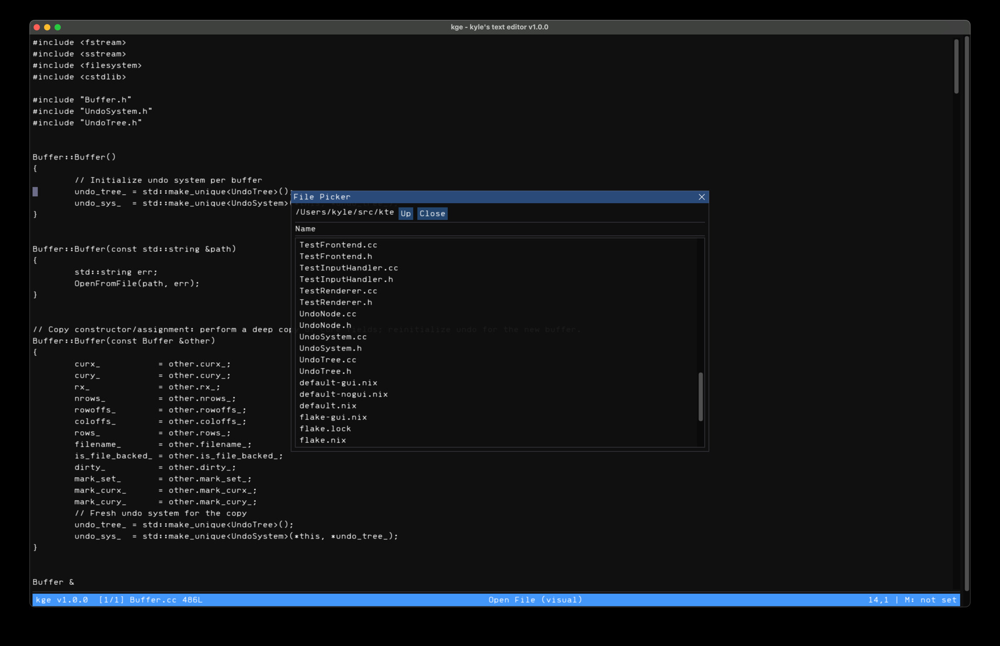

kte - Kyle's Text Editor
========================



kte is a small text editor with WordStar-style `C-k` commands and a
few Emacs habits. It comes in two forms that share one editor core:

- `kte` runs in a terminal (ncurses).
- `kge` is the graphical version (SDL2, OpenGL and Freetype through
  Dear ImGui). It adds themes, a choice of embedded fonts and multiple
  windows.

This project is a hobby text editor meant to be my personal editor. I
do not warrant its suitability for anyone else.


Getting kte
-----------

The source lives at <https://github.com/kisom/kte> (mirrored from
`git.wntrmute.dev:kyle/kte`):

```
git clone https://github.com/kisom/kte.git
cd kte
```

On macOS you can skip building and use Homebrew:

```
brew install kisom/tap/kte          # terminal editor
brew install --cask kisom/tap/kge   # graphical editor (kge.app)
```

Each [GitHub release](https://github.com/kisom/kte/releases) also has a
prebuilt `kge.app.zip` for macOS.


Building
--------

You need a C++20 compiler, CMake and ncurses. The GUI also needs SDL2
and Freetype (plus OpenGL, which macOS already provides). If PCRE2 is
installed, regex search uses it; otherwise kte falls back to
`std::regex`.

Install the dependencies:

- macOS (Homebrew): `brew install cmake ncurses sdl2 freetype pcre2`
- Debian/Ubuntu: `sudo apt-get install -y build-essential cmake
  pkg-config libncurses-dev libsdl2-dev libfreetype6-dev mesa-common-dev
  libpcre2-dev`
- Alpine: see the package list in the `Dockerfile`.
- Nix: `nix develop` gives you a shell with everything (`nix develop
  .#terminal` for the terminal-only set).

Then configure and build:

```
cmake -S . -B build -DCMAKE_BUILD_TYPE=Release
cmake --build build
```

That builds `build/kte` and `build/kge` (on macOS, `build/kge.app`). To
build only the terminal editor, and skip the GUI dependencies, add
`-DBUILD_GUI=OFF` to the first command. `-DBUILD_TESTS=OFF` skips the
test suite.

With Nix you can also build straight from the flake: `nix build .#kte`
or `nix build .#kge`.


Installing
----------

```
sudo cmake --install build
```

This installs into `/usr/local` by default (pick another place with
`--prefix DIR`). You get the `kte` and `kge` binaries, the `kte(1)` and
`kge(1)` man pages, and on Linux a desktop entry and icons for kge. On
macOS the install puts the app at `/usr/local/kge.app` (that is, under
the prefix); move it to `/Applications`, or just copy `build/kge.app`
there yourself.

To install from Nix: `nix profile install .#kte` (or `.#kge`).


Using kte
---------

Open files by naming them:

```
kte notes.md main.cc
kge +120 Buffer.cc       # open Buffer.cc at line 120
```

With no files you get an empty buffer. `kte` always runs in the
terminal; `kge` opens a window, and `kge --term` runs it in the
terminal instead.

Most commands start with `C-k` (Control-K) followed by another key.
`C-g` cancels anything half-typed. Press `C-k h` for the built-in help,
which lists every binding; the man page (`man kte`) has the same list
with more detail. The ones you need on day one:

| Keys                    | What it does                                  |
|-------------------------|-----------------------------------------------|
| `C-k s`                 | Save (asks for a name if the buffer has none) |
| `C-k x`                 | Save and quit                                 |
| `C-k q`                 | Quit; press it twice to discard changes       |
| `C-k e`                 | Open another file                             |
| `C-k b`, `C-k n`/`C-k p`| Switch buffers; previous/next buffer          |
| `C-k c`                 | Close the current buffer                      |
| `C-k u`, `C-k r`        | Undo, redo                                    |
| `C-k g`                 | Go to a line                                  |
| `C-a`/`C-e`             | Start/end of line                             |
| `C-f`/`C-b`/`C-n`/`C-p` | Right/left/down/up (arrow keys work too)      |
| `ESC f`/`ESC b`         | Next/previous word                            |
| `ESC <`/`ESC >`         | Start/end of the file                         |
| `C-s`, `C-r`            | Incremental search, regex search              |
| `C-h`, `C-t`            | Search and replace, regex search and replace  |
| `ESC m` or `C-k SPACE`  | Set the mark (start a selection)              |
| `C-w`, `ESC w`, `C-y`   | Cut, copy, paste (kill, copy, yank)           |
| `C-k d`, `C-k C-d`      | Delete to end of line; delete the whole line  |
| `ESC q`                 | Reflow the paragraph to 72 columns            |
| `C-u N`                 | Repeat the next command N times               |

`ESC` followed by a key is the same as holding Alt (Meta) and pressing
it.

`C-k ;` opens a command prompt for things that don't have a key. Type
a command and press Enter; Tab completes. For example:

```
: syntax off
: set filetype=python
: theme gruvbox          (kge)
: font-size 20           (kge)
```

If kte crashes or the machine goes down, your edits aren't lost. Each
buffer keeps a journal under `~/.local/state/kte/swap/`, and the next
time you open the file kte asks whether to recover them.


### kge: themes, fonts and windows

kge has 15 color themes and two dozen built-in fonts. Switch themes
while you work with `: theme NAME`, and change the text size with Ctrl
`+`/`-`/`0` (Cmd on macOS). Fonts are chosen in the config file below. `C-k m` switches between code
mode (a monospace font) and writing mode (a proportional font, used by
default for `.md`, `.txt` and similar files). Cmd+N (macOS) or
Ctrl+Shift+N opens another window onto the same buffers.

Settings that should stick go in `~/.config/kte/kge.toml`:

```toml
[font]
name = "iosevka"   # the font for everything not set below
size = 18.0        # in pixels
writing = "etbook" # the font for writing mode

[appearance]
theme = "gruvbox"
background = "light"
```

[CONFIG.md](CONFIG.md) lists every setting, font and theme, and
[docs/themes.md](docs/themes.md) explains how to add a theme. The
terminal editor has no configuration file.


More documentation
------------------

- `kte(1)`, `kge(1)`: the man pages (`docs/kte.1`, `docs/kge.1` in
  the source tree).
- [docs/DEVELOPER_GUIDE.md](docs/DEVELOPER_GUIDE.md): how the code is
  put together, for anyone working on kte itself.
- [docs/ke.md](docs/ke.md): the manual for ke, the older C editor kte
  replaces. Most of its bindings carried over, but not all of them.
